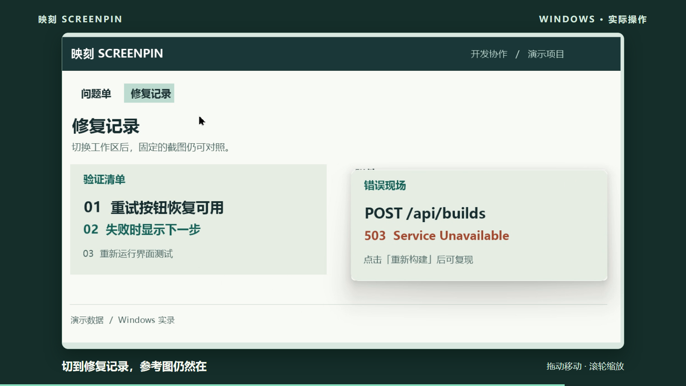

# 映刻 Screenpin

映刻是 Windows 桌面截图工具。平时可收在托盘，用全局快捷键截图、贴图、截长图和录屏。

[](docs/media/screenpin-intro.mp4)

[观看 16 秒 Windows 实录（无声 MP4）](docs/media/screenpin-intro.mp4)

当前支持 Windows 区域截图、截图自动复制与临时贴图、图钉固定、选区滚动截图、选区 MP4 录屏、后台快捷键、托盘常驻、单实例及 PNG 图片处理。

主窗口负责启动和设置，日常不需要一直显示。关闭窗口会收起到托盘，快捷键继续有效；再次运行程序会唤回原面板，不会重复运行。通过托盘菜单或面板的「退出程序」才会真正结束进程。托盘创建失败时保留窗口，避免无法操作。

「工作台」把截图与贴图、滚动长图与录屏分组，当前有图片时可查看图片、直接保存 PNG、提取文字或识别二维码。「设置」管理快捷键与外观。区域截图时面板先隐藏，再冻结桌面供框选；松开鼠标自动复制，直接 Ctrl+V 粘贴到支持图片的应用。粘贴到 Windows 桌面或文件夹时会生成 PNG 文件。Esc 或右键取消，保留原有剪贴板。复制失败时保留截图并显示面板提示。

## 截图画质与贴图

截图按屏幕物理像素采集，保存和剪贴板 PNG 均为原始尺寸、无损编码，没有 JPEG 压缩和缩小导出。主窗口内「适应」仅影响预览；点击 `1:1` 可按设备像素显示，拖动查看大图。

贴图是圆角的纯图片浮窗，窗口随图片比例和显示器缩放确定大小；没有标题栏、底部文字、隐藏或关闭按钮，右键「保持显示」可切换固定状态，鼠标移到大图右上角时会显示图钉。拖动图片可移动窗口，滚轮缩放窗口内的图片并短暂显示相对原图的百分比，拖动边缘可调整浮窗大小，图片随窗口按比例缩放；Ctrl/⌘+0 切换原始像素查看，此时拖动可平移图片。

截图后默认自动显示临时贴图，点击窗口外就关闭；右键选「保持显示」或点大图的图钉后保留在其他窗口上方。Esc 或 Ctrl/⌘+W 可关闭。设置里的「截图后自动贴图」可关闭此功能，自动复制仍然保留。Ctrl+2 从剪贴板手动贴图，默认保持显示。右键贴图可提取文字或识别二维码，结果可选择、复制。文字识别支持微信 OCR 和 Windows OCR。自动模式优先使用本机可用的微信 OCR，并在组件缺失或识别失败时回退到 Windows OCR；也可指定简体中文或英语使用 Windows 语言包。微信 OCR 的本机辅助程序可用 `scripts/build-wechat-ocr.ps1` 构建，运行需要 .NET 10 和 STranslate 已安装的内置微信 OCR 组件；二维码只显示内容，不会自动打开链接。也可以在桌面或资源管理器复制 PNG、JPG、BMP、WebP 或 GIF 文件后贴图，动图显示首帧。圆角仅影响浮窗显示，复制和保存保留完整原图。

## 滚动截图

按 Ctrl+3，框选需要截取的正文区域，蓝色边框标出已锁定范围，然后在该区域内向任意一侧滚动，工具自动识别滚动轴与重叠内容，同一次可沿该轴向两端补拍，经过已有画面时自动跳过重复内容。点「撤回」可删除最近一段，滚回提示的上一段画面后继续，也可以直接完成。再次按 Ctrl+3 或点控制条「完成」，完成时会再采集一次当前画面。生成原始宽度的无损 PNG，自动复制并按设置贴图。控制条「取消」丢弃本次任务，保留剪贴板。

请选择正文，避开固定页头、浮动栏和动态广告。重复或无重叠内容会被拒绝并提示减慢滚动或回到上一画面，不会强行误拼。长图上限 3200 万像素。控制条优先放在选区外，选区铺满屏幕时，支持捕获排除的系统可把工具条放进选区。

## 录屏

按 Ctrl+4 框选范围，松开即开始录制，无倒计时，红色边框标出录制范围，贴着红框的控制条显示启动和计时状态。控制条可「暂停」和「继续」，暂停期间不采集画面或声音。再按 Ctrl+4 或点控制条「结束录制」打开预览。拖动进度条后可将当前位置设为起点或终点；选择 MP4、GIF 或 WebP 再导出。GIF 和 WebP 是无声动图。控制条「取消」会删除本次录制文件。使用 H.264、目标 30 fps、CRF 16；默认录制 Windows 默认播放设备的系统声音，可在工作台关闭。麦克风有独立开关，默认关闭。两个开关均开启时，声音混合到同一条 AAC 音轨。回放中的静音和音量只影响播放。奇数选区仅在右侧或底部补到偶数像素，不缩放原画面。

视频默认保存到用户的 `Videos/Screenpin`。在「设置 → 常规 → 录屏文件」可选择其他默认目录。预览里的「另存为」可以为单次导出另选位置。保存后可从托盘或面板打开最近录屏，默认目录内的录屏重启后仍可打开。录制中退出应用会先打开预览，供你决定保存或丢弃。编码器由应用管理，应用异常终止时不会留下持续录制的编码进程。

录屏需要 FFmpeg。请将 Windows 版 `ffmpeg.exe` 放到 `tools/ffmpeg`，或安装到 PATH。媒体验证脚本另需同目录的 `ffprobe.exe`。参见 [依赖说明](tools/ffmpeg/SOURCE.md)。

设置中可开启「启动后收起到托盘」。此选项只控制启动后的窗口，不会修改系统开机启动项。

毛玻璃默认开启，控制面板、设置和任务工具栏统一使用系统材质；贴图保留纯图片和透明圆角。图片像素不受影响。外观与启动偏好均会记忆。

## 自定义快捷键

进入顶部「设置」，可修改全局快捷键：

| 动作 | 默认值 |
| --- | --- |
| 区域截图 | Ctrl+1 |
| 剪贴板图片贴图 | Ctrl+2 |
| 滚动截图 / 完成长图 | Ctrl+3 |
| 区域录屏 / 停止录屏 | Ctrl+4 |
| 显示面板 | F8 |

macOS 上 Ctrl 对应 ⌘。输入组合键后点击「应用快捷键」，立即生效并保存。支持 Ctrl、Alt、Shift 加字母、数字或 F1–F12，也支持单独使用 F1–F12。界面显示 Ctrl/⌘，不显示内部名称 CmdOrCtrl。已有配置保留，使用恢复默认可改用新默认值。留空并应用可停用；「恢复默认快捷键」填回默认值，点击应用后生效。

组合键重复会被拒绝；被其他软件占用或保存失败时，保留原绑定和原配置。每项显示实际注册状态。交换两个动作的组合键时，先清空并应用，再填入新值。启动注册失败可修改后重新应用。

窗口内快捷键目前固定：Ctrl/⌘+O 打开、V 粘贴、C 复制、S 保存、P 贴图、+/− 缩放、0 适应、逗号打开设置；F1 查看帮助。贴图内 Esc 或 Ctrl/⌘+W 关闭，Ctrl/⌘+C 复制。

## 配置

系统用户配置目录下的 `Screenpin/`，Windows 通常为 `%APPDATA%\Screenpin\`：`settings.json` 保存外观、自动贴图、录屏保存目录和启动后收起偏好，`hotkeys.json` 保存全局快捷键。旧快捷键配置会补入新增动作的默认键，明确清空则保持停用。配置采用临时文件写入后替换，缺失时使用默认值，无效配置提示并回退。开发验证可用绝对路径环境变量 `SCREENPIN_VIDEO_DIR` 指定视频输出目录。

Windows 剪贴板提供原始 PNG、DIB 和兼容位图格式，不依赖面板可见或延迟提供器；PNG 保留透明度，兼容位图中的透明区域合成到白底。

## 构建与验证

在 Windows 上使用 Go 1.27.3 或兼容版本构建。录屏预览需要 WebView2 Runtime，Windows OCR 使用系统安装的识别语言包。构建完成后可直接运行生成的 screenpin-latest.exe。

```powershell
go test ./...
go vet ./...
go build -ldflags '-H windowsgui' -o screenpin-latest.exe .
go build -tags e2e -o artifacts/screenpin-check.exe .
pwsh -STA -File scripts/verify-desktop.ps1
pwsh -STA -File scripts/verify-hotkeys.ps1
pwsh -STA -File scripts/verify-glass.ps1
pwsh -STA -File scripts/verify-capture.ps1
pwsh -STA -File scripts/verify-media.ps1
pwsh -STA -File scripts/verify-pin.ps1
go test -tags mediae2e -run 'TestRecorder|TestCancelledRecording|TestEncoderGuard' -v ./internal/app
```

## 目录与进度

根目录的 `main.go` 是启动入口。`internal/app/` 放窗口、快捷键、截图、贴图和录屏流程，`internal/app/preview/` 放录屏预览页面。`internal/scroll/` 放长截图拼接，`internal/ocr/` 放文字和二维码识别，`internal/process/` 放后台进程管理。Go 测试和对应模块放在一起。`docs/` 收纳规划、设计、调研及历史原型记录；`scripts/` 放验证脚本；`artifacts/` 放截图和检查构建；`third_party/` 为构建必需的固定框架源码。发布用 EXE 位于根目录。

参考 [PixPin 全局动作配置](https://pixpin.cn/docs/configuration/actions) 和 [内置快捷键配置](https://pixpin.cn/docs/configuration/built-in-shortcut)，区分全局动作与窗口内操作。全局快捷键支持编辑、停用、恢复默认、占用反馈和持久化。

Windows 1920×1080 实屏验证：PNG 的每个像素、自动贴图与常驻切换、点击外部关闭，以及 160×335 滚动长图的全部像素通过校验；318×240 的动画 H.264 视频通过解码与帧变化验证，录制中退出也会保存可播放文件。富文本粘贴、后台快捷键、托盘、单实例与全局毛玻璃验证通过。细节见 [质量和媒体验证记录](docs/截图质量与媒体开发记录.md)。

标注和窗口内快捷键自定义尚未实现。截图后暂无标注确认步骤，松开鼠标即复制。多屏和混合 DPI 使用物理坐标实现，尚未完成多屏实机验收；HDR、受保护内容、macOS/Linux 截图尚未支持。
