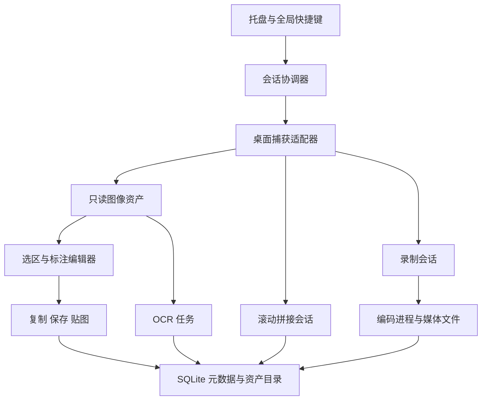

# 项目规划：以 PixPin 为目标的桌面截图工具

## 1. 产品目标与交付定义

目标用户是经常截图说明问题、对照资料、提取文字、记录操作的开发者和办公用户。核心价值是让“截取—编辑—复制/保存/悬浮参考”在一次连续操作中完成。

以 Windows 版本为首发平台，中文为默认界面。最终的功能对照以 [PixPin 3.6.6.0 官方日志](https://pixpin.cn/docs/official-log/3.6.6.0) 为固定基准。对标功能与交互，不承诺识别精度、内部算法和每个像素与原软件相同。

最终完整对标包含基础能力和高级能力。先分阶段交付是实现顺序，不是永久删掉 OCR、长截图或录屏。暂缓账户、收费系统、云同步，这些不影响本地截图工作流。

首发支持 Windows 10 22H2、Windows 11 x64。Windows ARM64、macOS 单独进入后续移植计划。Linux 和浏览器不是本版承诺的平台。屏幕捕获和全局热键不能靠 Web 版本实现同等权限与体验。

## 2. 如何界定“一模一样”

采用三层验收，而不是凭“看起来像”宣布完成：

1. 功能层：功能矩阵中的每项有入口、执行过程、完成/失败状态和可验证输出。
2. 交互层：按键、右键、拖动、滚轮、撤销和多窗口状态有明确规则；允许用户映射为 PixPin 使用习惯。
3. 输出层：文件、剪贴板、OCR 文本、拼接结果和录制内容用样本核对质量。

暂定项目名为“截图工具”，可执行文件名 `screenpin.exe`。正式命名在发布前决定；不使用 PixPin 的名称、图标或素材作为本程序标识。所有实现状态初始均为“待开发”。

## 3. UI 和日常操作

### 托盘常驻

启动后进入托盘，不强制打开大主窗口。菜单包含截图、贴图、历史、贴图组、设置、帮助与退出。退出时关闭窗口、解除热键、停止捕获，等待或取消写盘与编码任务。

快捷键兼容配置提供 Ctrl+1 截图、Ctrl+2 剪贴板贴图、Ctrl+3 恢复最近贴图。首次注册失败必须指出冲突并允许重绑，不能静默覆盖；用户同时运行 PixPin 时可以选择另一组组合键。PrintScreen 作为可选配置，不默认抢占。

### 截图覆盖层

先抓取桌面快照，再显示覆盖层，避免把自身遮罩截进去。暗化未选区域，选中区域保持原色。提供尺寸、坐标、取色、放大镜和浮动工具栏。工具栏靠近选区但不能跑出可视屏幕；空间不足时换侧。

左键框选、八方向调整边界、拖动内部移动、方向键微调、Esc 取消。取消要立刻恢复原焦点，保持之前的剪贴板内容。选区中的右键先撤销当前选择，再退出，具体策略可配置。

### 图片编辑

工具按“选择、形状、箭头、画笔、文字、遮挡、序号”组织。一级工具栏只放常用操作，参数面板跟随当前工具。提供线宽、颜色、透明度、字体、对象选择、撤销与重做。导出、复制、贴图使用同一渲染结果。

不把每次落笔直接烧进原图。原图加对象层作为编辑数据，导出时才合成；这样才能二次编辑、撤销和保留原始像素。

### 悬浮贴图

无边框、默认置顶。普通拖动移动窗口，滚轮围绕指针缩放，Ctrl+滚轮调整透明度。锁定和鼠标穿透是不同状态；开启穿透前提供恢复快捷键和托盘入口。文字可选模式与拖动冲突时，Alt+拖动始终移动窗口。

当前显示大小和原图像素分开保存。菜单明确区分“复制当前图像”“复制原始图像”“保存编辑后图像”。关闭进入历史，销毁不进入历史。分组切换隐藏其他组，不直接销毁其内容。操作对齐依据见 [官方贴图说明](https://pixpin.cn/docs/pin/base-use)。

### 长截图与录屏

从选区工具栏进入，复用选区和屏幕坐标。长截图展示累计预览、匹配状态、撤回最近片段和完成按钮；没有可信匹配时停止增长并说明原因。录屏展示独立状态条、计时、暂停、停止与取消，避免控制条进入录制内容。

设置页采用侧边导航与表单，分常规、快捷键、截图、贴图、标注、识别、长截图、录制、保存与存储。历史页支持缩略图、搜索、重新贴图与删除。其余界面不放无用装饰或复杂仪表盘。

## 4. 技术选型与验证门槛

| 层 | 主方案 | 必须验证的内容 |
| --- | --- | --- |
| 业务与任务调度 | Go | 取消、队列上限、退出清理、并发访问 |
| 桌面 UI | MyGo 原生 UI，固定版本 | 多覆盖窗、真实透明、中文输入、跨 DPI、焦点与键盘、工具栏定位 |
| 静态捕获 | Windows Win32/GDI 首条实现 | 黑屏检测、多个显示器、负坐标、旋转屏、光标选项 |
| 持续捕获 | DXGI / WGC 适配器 | COM/WinRT 调用、设备丢失、显示器变化、权限及系统捕获边框行为 |
| 图像编辑 | 自有对象模型与统一渲染接口 | 屏幕预览、复制和保存一致；先完成 CPU 正确性，再优化 GPU |
| 本地 OCR | ONNX Runtime + 选定 OCR 模型 | 模型转换、前后处理、语言与字典、离线运行、任务取消 |
| 媒体编码 | FFmpeg 子进程 | 参数与编码器支持、正常结束/取消、音画同步、进度与磁盘异常 |
| 数据存储 | SQLite + 文件资产 | 事务、迁移、崩溃恢复、引用计数、历史容量和清理 |
| 运行配置 | JSON | 版本字段、原子保存、损坏恢复、快捷键导入导出 |

MyGo 当前确实有置顶、窗口透明度和鼠标穿透等公共接口，但这些接口不等于完整截图基础设施。公开在审实现不能当成依赖已具备的功能。Gate 0 失败时，先定位具体障碍；若必须大改渲染器或窗口后端才能继续，保留 Go 核心，单独评估 Windows 原生覆盖层或调整 UI 框架。不能一边失败一边继续堆上层界面。

UI 选择不是已验证的全部技术结论。原版 PixPin 的技术栈没有从源码确认，本方案是针对你现有 Go/MyGo 经验做出的工程选择。

## 5. 模块与数据流



预期代码结构如下；这是设计目录，不表示这些模块已经存在：

```text
cmd/screenpin/             主程序与 worker 入口
internal/app/             生命周期、会话协调、动作路由
internal/platform/windows/系统捕获、热键、剪贴板、窗口与 DPI 适配
internal/capture/         帧、显示器、捕获提供者接口
internal/geometry/        坐标、矩阵、选区和裁剪
internal/editor/          标注对象、命令、撤销与渲染
internal/pin/             贴图、分组、视口与恢复
internal/ocr/             推理任务、模型管理、文字框与阅读顺序
internal/stitch/          帧匹配、片段图、回退与长图导出
internal/record/          时钟、帧队列、音频、编码与回放
internal/store/           配置、SQLite、迁移、文件资产
internal/ui/              覆盖层、工具栏、设置和历史界面
testdata/                 自制图像、滚动帧、录制样本和对照结果
scripts/                  构建、打包与验收工具
docs/                     接口、数据格式、发布与故障说明
```

核心数据对象：Asset、AnnotationDocument、PinState、CaptureSession、OCRJob、StitchSession、RecordingSession。Asset 保存不可变原始像素及来源信息；视口缩放不修改 Asset。编辑模型引用资产并存储形状、路径和变换。

主线程负责 UI。捕获、推理、编码、文件读写使用有限队列的后台任务，完成后投递状态。所有任务包含会话 ID、取消上下文、进度、结果和错误；旧任务不得覆盖新会话。大图帧和编码数据通过所有权明确的缓冲区或临时文件传递，不走 JSON/Base64 消息队列。

OCR 放入按需启动的 worker 进程也可使用同一个 Go 可执行文件的内部子命令，避免推理运行时故障带崩托盘。FFmpeg 使用独立进程。IPC 使用本机命名管道或带访问限制的本地连接，协议只传任务与资产引用。

## 6. 五个关键工程问题

### 6.1 坐标系统

明确四套坐标：虚拟桌面物理像素、单显示器局部物理像素、窗口逻辑 DIP、原图像素。屏幕可能位于主屏左上方，因此全局原点可以为负值。用类型或命名区分坐标，避免全项目使用同一个 Rect。

每块屏幕独立捕获和转换，再按物理像素合成跨屏选区。不可用“统一乘以主屏缩放率”处理所有显示器。选区、OCR 框、标注、鼠标和导出必须通过同一变换模块。DPI 策略参考 [微软 PMv2 说明](https://learn.microsoft.com/en-us/windows/win32/hidpi/high-dpi-desktop-application-development-on-windows)。

缩放时以指针为锚点。设平移 p、鼠标 m、缩放从 s 到 s'，使用 p'=m-(s'/s)(m-p)。旋转、裁剪和镜像通过统一矩阵组合；命中检测应用逆矩阵。测试要验证变换往返以及旋转后的 OCR 选择。

### 6.2 标注与导出

采用 Command 模式记录添加、删除、移动和修改属性。一次拖动是一条可撤销命令，不能每个鼠标移动事件保存整张图。文本保留字体、对齐和布局信息；缩放预览不改变实际导出字号。

原图与编辑结果分开。“马赛克”和“模糊”是显示效果，敏感数据还需要不透明覆盖选项。导出的遮挡必须实际写入像素，不能只加可移除的覆盖层。裁剪越界、空区域和巨大图片提前拒绝或明确降级。

### 6.3 OCR

流程为区域预处理 → 检测文本区域 → 方向/矫正 → 识别 → 文字框排序 → 文本输出。文本识别结果必须包含原图坐标，以便在贴图上拖动选择。不要只提供一个弹窗文本框就宣布完成 PixPin 式 OCR。

先做中英文离线识别，再增加其他语言。模型和字典必须同版本。OCR 缓存以资产内容、裁剪区、模型版本和参数为键，编辑图片后不能复用旧结果。Worker 任务队列有上限，贴图关闭取消尚未完成的任务。模型可延迟下载，但下载后断网必须能工作；完整离线包另行打包。

Windows 系统 OCR 可评估为可选适配器，不能假设便携版在所有系统都直接可用。[官方 OCR API](https://learn.microsoft.com/en-us/uwp/api/windows.media.ocr.ocrengine) 与部署约束要做实际验证。ONNX 路线也有运行时库、模型和许可证成本；不称为“纯 Go 无依赖 OCR”。

### 6.4 长截图

采用可回退的片段图保存拼接结果，避免每来一帧就重新分配整张长图。缩略预览用缩小缓存，最终导出逐条带渲染。固定标题栏、滚动条和动画区域作为掩码参与匹配，不直接当作新增正文。

匹配流程：抽取灰度/边缘 → 候选位移搜索 → 多区域一致性校验 → 置信度判断 → 去除重叠并追加。低置信度停住，保留之前的结果，让用户回退或缩小选区。重复文本、空白、反向滚动和滚到底部必须单独处理。

优先手动滚动纵向拼接，再支持横向和自动滚动。自动滚动必须针对用户选中的目标窗口，随时可停止。浏览器 DOM 全页截图可作为未来单独模式，不能冒充任意应用长截图。实际限制依据 [官方长截图说明](https://pixpin.cn/docs/capture/long-capture) 对齐，但不照搬其最大长度作为未经测试的承诺。

### 6.5 录制

录制状态为 Idle、Ready、Recording、Paused、Stopping、Exporting、Completed、Failed。所有帧和音频用统一单调时间线，暂停时从输出时间线中扣掉暂停段。录制不依赖 UI 绘制帧率。

快速模式边采集边编码，优先 MP4；普通模式保存可回放的中间素材，结束后导出 MP4、GIF 或 WebP。GIF 调色板与编码独立配置。帧队列满时记录丢帧和降低质量，不允许内存无上限增长。

FFmpeg 先通过可探测的命令行能力接入，按路径定位本地编码器。系统音频、麦克风、设备切换和音画同步分别验收。先做到停止后文件可播放，再做鼠标轨迹、按键显示、画中画与两端裁切。普通录制与快速录制的产品区别参考 [官方录制文档](https://pixpin.cn/docs/capture/gif-capture2)。

## 7. 数据、资源与发布

建议数据目录：config.json、metadata.db、assets/、thumbs/、recordings/、models/、tmp/、logs/。便携模式使用显式 portable 标志和可写路径检查；默认放用户数据目录，不在安装目录写入。

元数据包括内容哈希、来源、尺寸、创建时间、标签、OCR 文本、分组和编辑文档路径。像素和视频不直接塞进数据库。引用计数在删除贴图、历史和编辑文档时更新，清理不得删除仍被引用的原图。历史有条数和磁盘限额；原图不保存在普通诊断日志中。

每个会话持有需要释放的窗口、热键、GDI/D3D 对象、文件和子进程。每次退出和设备失效有同一条清理路径。贴图缩略图和 OCR 缓存有可配置上限；长截图和录制素材采用磁盘配额，不能仅靠 GC 控制。

发布产物区分基础便携包、含 OCR 的离线包和录制组件。记录每个运行时与模型的版本、哈希和来源。自动更新放到基础功能稳定后，要求下载校验、失败回退和用户可控。当前阶段不生成安装程序、不创建远程仓库、不发布软件。

## 8. 规模、投入与取舍

以下是开发估算，不是交付承诺。以一名熟悉 Go 与 Windows 桌面开发、每周投入约 25–35 小时为条件：

| 目标 | 累计参考周期 | 说明 |
| --- | --- | --- |
| Gate 0 | 1–2 周 | 框架和系统能力实测，决定是否继续原方案 |
| v0.1 | 5–8 周 | 每天能用的截图、标注和贴图闭环 |
| v0.2 | 8–12 周 | 本地 OCR、历史、分组和识别文字选择 |
| v0.3 | 12–18 周 | 有质量门槛的长截图 |
| v0.4–0.5 | 18–28 周 | 录制、音频、回放和打包 |
| 高级能力与广泛兼容 | 6–12 个月以上 | 结构化识别、窗口实时贴图、脚本、移植和长期回归 |

如果同时学习 Win32、图形、OCR 与桌面 UI，周期通常更长。完整达到成熟产品的稳定性需要持续使用反馈，不适合承诺几天完整复刻。高级识别还可能产生模型下载、算力和外部翻译 API 成本。

## 9. 开始开发前的决定

推荐按此方案实施，但第一项工作必须是技术验证，不是画一个静态设置页。Gate 0 通过后冻结依赖、坐标与编辑数据格式，按 v0.1 验收清单推进。开发过程以可用的纵向功能链交付，每个里程碑都有真实操作录像和失败用例，避免再次出现“做了演示但核心能力没实现”的情况。
